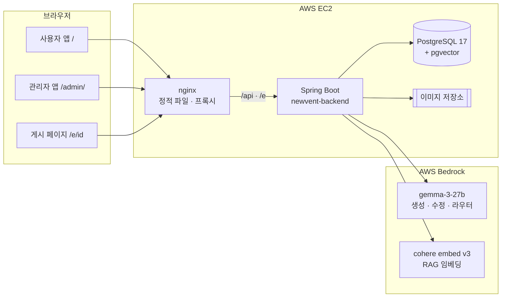

# NewVent

**AI 기반 이벤트 페이지 제작 및 게시 관리 시스템 구현 프로젝트**

> 어떤 이벤트를 하고 싶은지 말하면, 페이지가 나오고, 게시하면, 사용자가 참여합니다.

<p align="center">
  
</p>

---

## 목차

1. [프로젝트 개요](#1-프로젝트-개요)
2. [한눈에 보기](#2-한눈에-보기)
3. [주요 기능](#3-주요-기능)
4. [시스템 구성](#4-시스템-구성)
5. [페이지가 만들어지는 과정](#5-페이지가-만들어지는-과정)
6. [설계 원칙](#6-설계-원칙)
7. [저장소](#7-저장소)
   - [newvent-backend](#newvent-backend)
   - [newvent-frontend](#newvent-frontend)
   - [model-benchmark](#model-benchmark)
8. [기술 스택](#8-기술-스택)
9. [문서](#9-문서)

---

## 1. 프로젝트 개요

### 왜 만들었나

이벤트 페이지 하나를 올리려면 보통 **세 사람의 손**을 거칩니다.

```
기획자: 문서 작성  →  디자이너: 시안 제작  →  개발자: 퍼블리싱  →  게시
```

이벤트는 짧고 자주 열리는데, 페이지 한 장을 위해 매번 이 과정을 처음부터 반복합니다.
문구 하나, 색 하나를 바꾸는 것도 다시 디자이너와 개발자에게 돌아가야 합니다.

### 무엇을 만들었나

NewVent는 이 과정을 **"어떤 이벤트를 하고 싶은지 말하면 페이지가 나오는"** 하나의 화면으로 줄입니다.

| 기존 | NewVent |
| --- | --- |
| 기획 문서 → 시안 → 퍼블리싱 | 요청문 한 줄 → LLM이 페이지 생성 |
| 수정할 때마다 디자이너 · 개발자에게 요청 | 말로 고치거나(AI 수정), 화면에서 바로 고침(직접 수정) |
| 잘못 고치면 되돌리기 어려움 | 모든 변경이 버전으로 남고 언제든 되돌림 |
| 게시 후 참여 · 추첨은 별도 시스템 | 게시 · 참여 · 추첨 · 결과 발표까지 한곳에서 |

### 무엇을 지키려 했나

LLM에게 페이지를 맡기되, **결과는 서비스가 책임질 수 있어야** 합니다.

- 모델이 무엇을 내놓든, 게시되는 HTML은 서버가 정한 블록 · 디자인 범위를 벗어나지 않습니다.
- 모델이 기간 · 금액 같은 값을 지어내거나 바꾸면 검증에서 걸러냅니다.
- 알아듣지 못한 요청은 추측하지 않고 관리자에게 되묻습니다.
- 어떤 모델을 쓸지는 감이 아니라 [측정](#model-benchmark)으로 정했습니다.

---

## 2. 한눈에 보기

```
관리자  "가을 응원 이벤트 만들어줘. 혜택은 쿠폰 3종."
   │
   ├─ ① 생성      LLM이 페이지를 만듭니다 (비슷한 과거 이벤트를 RAG로 참고)
   ├─ ② 미리보기   실제 게시될 모습 그대로 확인합니다
   ├─ ③ AI 수정    "제목을 좀 더 크게" → 그 블록만 다시 만듭니다
   ├─ ④ 직접 수정  문구 · 글자 서식 · 블록 순서 · 삭제 · 이미지 (모델 호출 없음)
   ├─ ⑤ 버전      저장 · 체크포인트 · 되돌리기
   └─ ⑥ 게시
         │
사용자   이벤트 페이지에서 참여 → 추첨 · 결과 발표 → 내 혜택에서 확인
```

| 항목 | 내용 |
| --- | --- |
| 생성 모델 | AWS Bedrock `gemma-3-27b` ([선정 근거](#model-benchmark)) |
| 임베딩 모델 | AWS Bedrock `cohere.embed-multilingual-v3` (1024차원, pgvector) |
| 디자인 레지스트리 | 블록 14 · 변형 202 · 팔레트 144 · 테마 11 · 배치 13 |
| 기본 템플릿 | 5종 (스포츠 응원 · 한가위 선물 · VIP 감사 · 72시간 특가 · 서비스 사전예약) |
| 참여 방식 | 기본(즉시·확정·추첨) · 스포츠 승부 예측 · 사전 등록 · 복주머니 |

---

## 3. 주요 기능

### 관리자

| 기능 | 설명 |
| --- | --- |
| **이벤트 생성** | 템플릿에서 시작하거나, 요청문 한 줄로 백지에서 생성합니다. 비슷한 과거 사례와 추천 요청문을 함께 보여줍니다. |
| **AI 대화 수정** | 미리보기에서 블록을 최대 4개 골라 말로 고칩니다. 라우터가 요청을 작업 단위로 나눠 필요한 블록만 다시 만듭니다. |
| **직접 수정** | 문구, 글자 색·크기·굵기, 버튼·제목 스타일, 블록 순서, 배치·모양, 블록·항목 삭제를 모델 없이 바로 반영합니다. |
| **이미지** | 이미지를 올려 페이지에 넣습니다 (png·jpeg·gif·webp, 3MB). |
| **버전 관리** | 모든 변경이 버전으로 남습니다. 체크포인트를 찍고 언제든 되돌립니다. |
| **게시 관리** | 게시 · 게시 내리기 · 종료 · 휴지통 · 복원. 종료일이 지나면 자동으로 종료합니다. |
| **참여자 관리** | 참여 방식 설정, 참여자 목록, 승부 예측 결과 입력, 당첨자 CSV 내려받기 |
| **템플릿 라이브러리** | 잘 만든 페이지를 내 템플릿으로 등록해 다시 씁니다. |
| **RAG 대시보드** | 색인 현황, 검색 미리보기, 품질 추이, 전체 재색인 |
| **알림 · 사용자 관리** | 이벤트 시작 · 마감 임박 · 종료 알림, 회원 요금제 · 등급 관리 |

### 사용자

| 기능 | 설명 |
| --- | --- |
| **이벤트 탐색** | 진행 중 · 예정 이벤트를 둘러봅니다. 예정 이벤트는 미리 볼 수 있고 참여는 시작 후에 열립니다. |
| **참여** | 이벤트 페이지 안에서 바로 참여합니다. 회원 등급에 따라 참여 가능 여부가 정해집니다. |
| **내 혜택** | 참여 내역과 당첨 결과를 확인합니다. |

---

## 4. 시스템 구성



- **사용자 앱과 관리자 앱은 따로 빌드합니다.** 관리자 번들(편집 화면 · 채팅)은 무겁고 공개 화면에 내려갈 이유가 없기 때문입니다.
- **게시 페이지는 백엔드가 만들어 내려주고**, 스타일(`event.css`)과 동작(`event-runtime.js`)은 프론트 저장소가 관리합니다.
- **배포:** GitHub Actions → OIDC → ECR / S3 → SSM → EC2. 실패하면 이전 이미지로 롤백합니다.

---

## 5. 페이지가 만들어지는 과정

### 생성

```
요청문
  → 필터링      길이 · 개인정보 감지 · 너무 모호하면 되묻기
  → RAG 검색    비슷한 과거 이벤트 문구를 참고 예시로
  → 프롬프트    레지스트리에서 기본 항목 + 요청문이 부른 확장 항목만
  → LLM 호출
  → 정화        허용 목록 밖 태그 · 속성 제거
  → 검증        구조 · 값 보존 · 지어낸 값 탐지 ── 실패하면 이유를 붙여 재시도 (최대 4회)
  → 마무리      기간 · 버튼 링크 슬롯, 동작(카운트다운 등), 배치, 공통 유의사항
  → 버전 저장
```

### AI 수정

```
요청문 (+ 고른 블록)
  → 라우터      "무엇을 · 어디에"를 작업 최대 3개로 나눔
  → 게이트      서버가 맡는 블록 · 지원 안 하는 색 등은 관리자에게 되묻기
  → 작업마다    삭제 · 배치 · 이미지는 모델 없이 / 나머지는 그 블록만 LLM 수정 → 검증 → 병합
  → 버전 저장
```

---

## 6. 설계 원칙

| 원칙 | 이유 |
| --- | --- |
| **LLM 출력 계약은 `registry` 한 곳에** | 블록 · 변형 · 팔레트 · 검증 규칙이 흩어지면 프롬프트와 검증기가 서로 다른 말을 합니다. |
| **모델 출력은 정화 → 검증 → 병합** | 모델이 무엇을 내놓든 게시되는 HTML은 서버가 정한 범위를 벗어나지 않습니다. |
| **블록 단위로 수정** | 전체를 다시 만들면 고치지 않은 곳까지 바뀝니다. |
| **모델이 필요 없으면 부르지 않음** | 문구 · 서식 · 순서 · 삭제 · 이미지는 서버가 정확하게, 비용 없이 처리합니다. |
| **못 알아들으면 되묻기** | 모델에게 다시 시키는 대신 관리자에게 묻습니다. 되묻기는 실패가 아닙니다. |
| **레지스트리는 필요한 것만 싣기** | 기본 항목만 늘 싣고, 확장 항목은 요청문이 부를 때만 넣어 프롬프트를 짧게 유지합니다. |
| **슬롯은 보여줄 때 채움** | 기간을 저장 시점에 박으면 이벤트 기간만 고쳐도 화면이 안 바뀝니다. |
| **모든 모델 호출은 장부에** | 호출마다 토큰 · 실패 사유를 남기고 하루 상한을 겁니다. |

되돌리기 어려운 선택은 [결정 기록(ADR)](https://github.com/New-Vent/newvent-backend/tree/develop/docs/decisions)에 이유와 함께 남겼습니다.

---

## 7. 저장소

| 저장소 | 역할 | 스택 |
| --- | --- | --- |
| [**newvent-backend**](https://github.com/New-Vent/newvent-backend) | API · LLM 파이프라인 · 검증 · 참여 · RAG | Java 21 · Spring Boot 4.1 · PostgreSQL 17 + pgvector |
| [**newvent-frontend**](https://github.com/New-Vent/newvent-frontend) | 사용자/관리자 화면 · 이벤트 페이지 CSS | Vite 8 · 바닐라 JS |
| [**model-benchmark**](https://github.com/New-Vent/model-benchmark) | 어떤 LLM을 쓸지 정한 실험 기록 | Python · Ollama → AWS Bedrock |

### newvent-backend

생성 · 수정 · 검증 · 게시 · 참여가 모두 여기 있습니다. 패키지는 도메인 단위로 나눴습니다.

```
src/main/java/com/newvent/
├─ registry/       ★ LLM 출력 계약
│                    블록 · 변형 · 팔레트 · 테마 · 배치 · 이미지 · 동작 · 슬롯
│                    정화 · 검증 · 병합 · 프롬프트 빌더
├─ generation/     페이지 생성(템플릿 · 백지) · 작업 폴링 · 재시도 · 호출 장부 · 일일 상한
├─ editor/         AI 수정 · 라우터 · 게이트(되묻기)
├─ event/          이벤트 · 버전 · 직접 수정 · 게시 · 휴지통 · 공개 조회 · 템플릿 라이브러리
├─ rag/            임베딩 · 유사 사례 검색 · 요청문 추천 · 품질 추이
├─ participation/  참여 방식 · 등급 제한 · 추첨 · 발표
├─ asset/          이미지 업로드
├─ filtering/      요청문 개인정보 감지
├─ notification/   관리자 알림
├─ auth/           JWT · 사용자/관리자 쿠키 분리 · Origin 검사
├─ infra/llm/      LLM 클라이언트: mock · ollama · bedrock
└─ user/ admin/ common/
src/main/resources/
├─ db/migration/   Flyway V1~V23
├─ templates/      기본 템플릿 5종
└─ notices/        공통 유의사항
```

### newvent-frontend

**런타임 의존성이 0개입니다.** 프레임워크 없이 바닐라 JS로 만들었고, Vite는 빌드에만 씁니다.

```
src/
├─ user/           사용자 앱: /         탐색 · 참여 · 내 혜택
├─ admin/          관리자 앱: /admin/   생성 · AI 수정 · 직접 수정 · 버전 · 게시 · 참여자 · 템플릿 · RAG
├─ shared/         API · 라우터 · 상태 · 미리보기 (두 앱이 함께 씀)
└─ event-css/      ★ 이벤트 페이지 CSS (12개 계층, 파일 순서가 곧 우선순위)
                     00 tokens · 10 fallback · 20 themes · 30 base · 40 templates · 50 blocks
                     60 variants · 70 components · 80 layouts · 90 palettes · 95 assets · 99 a11y
public/assets/     event.css · event-runtime.js (게시 페이지가 링크)
scripts/           event.css 빌드 · 팔레트 생성 (대비 · 색 거리 자동 검사)
deploy/            nginx 설정 · 배포 스크립트
tests/             회귀 테스트 (node:test)
```

### model-benchmark

"어떤 모델을 쓸까"를 감이 아니라 **측정으로 정한 기록**입니다.
v1~v7은 로컬 Ollama, v8부터 AWS Bedrock으로 옮겼고 **v11에서 `gemma-3-27b`로 확정**했습니다.

| 결론 | |
| --- | --- |
| 선정 | `gemma-3-27b`: `claude-haiku-4.5`와 **동점인데 비용은 1/9** |
| 갈린 축 | 생성 · 수정은 네 모델 모두 만점이라 변별력이 없었고, **라우터 하나**에서 갈렸습니다 |
| 배운 것 | 채점기가 틀려 모델을 과소평가한 것, 통과율이 거짓말을 한 것, 렌더해 보지 않아 놓친 것 |

```
base/              공통 엔진: engine · registry · checks · run
versions/v1~v11/   버전별 실험: 케이스 · 프롬프트 · 채점기 · README
docs/              방법론 · 버전별 리포트 · 실패 분석
```

---

## 8. 기술 스택

| 구분 | 기술 |
| --- | --- |
| Backend | Java 21 · Spring Boot 4.1 · Spring Security · Spring Data JPA · Flyway · jsoup |
| Database | PostgreSQL 17 · pgvector (HNSW) |
| AI | AWS Bedrock (gemma-3-27b · cohere embed v3) · Ollama (로컬 개발) |
| Frontend | Vite 8 · 바닐라 JS · 계층형 CSS |
| Infra | AWS EC2 · nginx · ECR · S3 · SSM · Docker Compose |
| CI/CD | GitHub Actions (OIDC) |

---

## 9. 문서

| 문서 | 위치 |
| --- | --- |
| API 명세 | 백엔드 실행 후 Swagger UI (`/swagger-ui.html`) |
| API 설계 배경 · 공통 규약 · 오류 코드 | [newvent-backend/docs](https://github.com/New-Vent/newvent-backend/tree/develop/docs) |
| 프롬프트 빌더 · RAG 평가 | [newvent-backend/docs](https://github.com/New-Vent/newvent-backend/tree/develop/docs) |
| 결정 기록 (ADR) | [newvent-backend/docs/decisions](https://github.com/New-Vent/newvent-backend/tree/develop/docs/decisions) |
| 프론트 팀 설정 · API 계약 | [newvent-frontend/docs](https://github.com/New-Vent/newvent-frontend/tree/main/docs) |
| 모델 선정 실험 | [model-benchmark](https://github.com/New-Vent/model-benchmark) |
